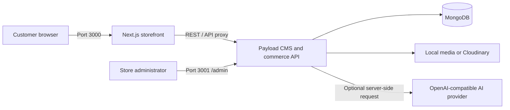

# NH EV Trader

NH EV Trader is a full-stack e-commerce application for electric vehicles, EV chargers, charging cables, and related accessories. It replaces a traditional WordPress store with a modern Next.js storefront and a dedicated Payload CMS administration panel.

The repository follows a separated frontend/backend architecture:

- `frontend/` contains the public customer-facing store.
- `backend/` contains Payload CMS, the administration panel, REST APIs, authentication, checkout logic, inventory management, and MongoDB integration.

> Current project status: local development is complete and connected. Deployment has not been performed. Cash on Delivery is active; an online payment gateway requires provider onboarding and credentials.

## Table of contents

- [Main features](#main-features)
- [Technology stack](#technology-stack)
- [Architecture](#architecture)
- [Repository structure](#repository-structure)
- [Requirements](#requirements)
- [Local setup](#local-setup)
- [Environment variables](#environment-variables)
- [Database seeding](#database-seeding)
- [Running the project](#running-the-project)
- [Storefront routes](#storefront-routes)
- [AI shopping assistant](#ai-shopping-assistant)
- [CMS and data model](#cms-and-data-model)
- [Authentication and customer data](#authentication-and-customer-data)
- [Cart, wishlist, and checkout behavior](#cart-wishlist-and-checkout-behavior)
- [Order and inventory flow](#order-and-inventory-flow)
- [Media storage](#media-storage)
- [SEO implementation](#seo-implementation)
- [Validation and security](#validation-and-security)
- [Testing and quality checks](#testing-and-quality-checks)
- [Deployment](#deployment)
- [Troubleshooting](#troubleshooting)
- [Project support](#project-support)
- [Current limitations and exclusions](#current-limitations-and-exclusions)
- [Handover documentation](#handover-documentation)

## Main features

### Customer storefront

- Responsive homepage with CMS-managed hero slider.
- Product catalog for Vehicles, Chargers, and Accessories.
- Category filters, product search, stock state, pricing, and variants.
- Product detail pages with image gallery, specifications, purchasing controls, and related products.
- Customer registration, login, logout, and protected account dashboard.
- Account-scoped cart and wishlist behavior.
- Login-required wishlist, add-to-cart, and checkout actions.
- Secure Cash on Delivery checkout.
- Customer order history with expandable order cards.
- Ordered product image, variant, quantity, pricing, payment details, delivery address, and order status.
- Customer order cancellation for eligible `pending` or `confirmed` unpaid orders.
- Saved delivery addresses with add and edit functionality.
- Contact form with custom JavaScript validation and CMS inquiry storage.
- Custom loading, error, and 404 pages.
- Responsive desktop and mobile navigation.
- Floating AI shopping assistant with an animated greeting, quick questions, and responsive chat panel.
- Natural English and Roman Urdu answers grounded in live CMS products, prices, specifications, stock, delivery settings, and support details.

### Administration panel

- Product and category management.
- Product variants, pricing adjustments, SKU, specifications, and inventory.
- Product drafts, publishing, archiving, and version history.
- Order, payment-state, and fulfilment-state management.
- Inventory audit logs for sales, restocks, returns, and corrections.
- Customer and saved-address visibility for staff.
- Contact inquiry management.
- Homepage banner, featured-product, and site-content management.
- Local media upload with optional Cloudinary storage.
- Administrator and store-manager roles.

## Technology stack

| Layer | Technology |
| --- | --- |
| Storefront | Next.js 16 App Router, React 19, TypeScript |
| Styling | Tailwind CSS 3, PostCSS, Lucide icons |
| CMS and API | Payload CMS 3 on Next.js |
| Database | MongoDB / MongoDB Atlas |
| Database adapter | `@payloadcms/db-mongodb` |
| Rich text | Payload Lexical editor |
| Media | Local Payload uploads or Cloudinary |
| Image processing | Sharp |
| Authentication | Payload customer and staff authentication |
| Payments | Cash on Delivery; online provider adapter pending |
| AI assistant | Built-in catalog/FAQ fallback with optional OpenAI-compatible provider such as Gemini |

## Architecture



The storefront never calculates authoritative order totals or stock changes by itself. Checkout data is sent to the backend, where current products, variants, prices, stock, delivery charges, and customer authentication are verified before an order is created.

Default local services:

| Service | URL |
| --- | --- |
| Storefront | `http://localhost:3000` |
| Backend API | `http://localhost:3001/api` |
| Payload admin | `http://localhost:3001/admin` |
| Health endpoint | `http://localhost:3001/api/health` |
| MongoDB | `mongodb://127.0.0.1:27017/nh-ev-trader` |

## Repository structure

```text
nhevtrader/
├── frontend/
│   ├── public/images/             # Local storefront and seed images
│   ├── src/app/                   # App Router pages and frontend API proxies
│   ├── src/components/            # Commerce, content, and layout components
│   ├── src/data/                  # Development fallback catalog data
│   ├── src/lib/                   # Catalog, content, formatting, and auth helpers
│   ├── src/providers/             # Auth, catalog, cart, and wishlist state
│   ├── src/types/                 # Shared storefront TypeScript types
│   ├── .env.example
│   ├── next.config.ts
│   └── package.json
├── backend/
│   ├── src/access/                # Payload access-control functions
│   ├── src/app/                   # Payload/Next application routes
│   ├── src/collections/           # CMS collections and authentication models
│   ├── src/endpoints/             # Health, checkout, cancellation, and chatbot endpoints
│   ├── src/globals/               # Homepage and site-wide settings
│   ├── src/lib/                   # Cloudinary and backend utilities
│   ├── src/payload.config.ts      # Payload CMS configuration
│   ├── src/seed.ts                # Idempotent development catalog seed
│   ├── .env.example
│   └── package.json
├── docs/
│   ├── ADMIN-GUIDE.md
│   └── DEPLOYMENT.md
└── README.md
```

## Requirements

Install the following before running the project:

- Node.js `20.18.1` or newer.
- npm.
- MongoDB Community Server locally, or a MongoDB Atlas connection string.
- Git.
- Optional Cloudinary account for cloud-hosted media.
- Optional Gemini or another OpenAI-compatible API key for natural-language chatbot answers. The rule-based catalog and FAQ assistant works without one.
- PowerShell commands below assume Windows; equivalent npm commands work on macOS and Linux.

Check installed versions:

```powershell
node --version
npm --version
git --version
```

## Local setup

### 1. Clone the repository

```powershell
git clone https://github.com/ZainIrfan03/NHEVTrader.git
cd NHEVTrader
```

### 2. Install backend dependencies

```powershell
cd backend
npm install
```

### 3. Install frontend dependencies

```powershell
cd ..\frontend
npm install
```

### 4. Create environment files

```powershell
Copy-Item ..\backend\.env.example ..\backend\.env
Copy-Item .env.example .env.local
```

Edit both copied files before starting the applications. Never commit real secrets.

### 5. Start MongoDB

For a Windows MongoDB service:

```powershell
Get-Service MongoDB
Start-Service MongoDB
```

If MongoDB runs manually or through Atlas, make sure `DATABASE_URL` in `backend/.env` points to the correct database.

## Environment variables

### Backend: `backend/.env`

| Variable | Required | Purpose |
| --- | --- | --- |
| `PAYLOAD_SECRET` | Yes | Signs Payload authentication data. Use at least 32 random characters in production. |
| `DATABASE_URL` | Yes | Local MongoDB or MongoDB Atlas connection string. |
| `NEXT_PUBLIC_SERVER_URL` | Yes | Public origin of the backend service. |
| `FRONTEND_URL` | Yes | Allowed storefront origin for CORS and CSRF. |
| `CLOUDINARY_CLOUD_NAME` | No | Cloudinary cloud name. |
| `CLOUDINARY_API_KEY` | No | Cloudinary API key. |
| `CLOUDINARY_API_SECRET` | No | Cloudinary API secret. |
| `CLOUDINARY_FOLDER` | No | Upload folder; defaults to `nh-ev-trader`. |
| `PAYMENT_PROVIDER` | Yes | Currently `manual`; online checkout stays unavailable. |
| `PAYMENT_SECRET_KEY` | Later | Future online payment provider secret. |
| `PAYMENT_WEBHOOK_SECRET` | Later | Future verified payment webhook secret. |
| `CHATBOT_API_URL` | No | OpenAI-compatible chat-completions endpoint. Leave empty to use the built-in fallback assistant. |
| `CHATBOT_API_KEY` | No | Server-only AI provider key. Never expose or commit it. |
| `CHATBOT_MODEL` | No | Provider model identifier used by the assistant. |

Example:

```dotenv
PAYLOAD_SECRET=replace-with-at-least-32-random-characters
DATABASE_URL=mongodb://127.0.0.1:27017/nh-ev-trader
NEXT_PUBLIC_SERVER_URL=http://localhost:3001
FRONTEND_URL=http://localhost:3000

CLOUDINARY_CLOUD_NAME=
CLOUDINARY_API_KEY=
CLOUDINARY_API_SECRET=
CLOUDINARY_FOLDER=nh-ev-trader

PAYMENT_PROVIDER=manual
PAYMENT_SECRET_KEY=
PAYMENT_WEBHOOK_SECRET=

CHATBOT_API_URL=
CHATBOT_API_KEY=
CHATBOT_MODEL=
```

### Frontend: `frontend/.env.local`

| Variable | Required | Purpose |
| --- | --- | --- |
| `NEXT_PUBLIC_API_URL` | Yes | Payload REST API base URL, including `/api`. |
| `NEXT_PUBLIC_SITE_URL` | Yes | Public storefront origin used for metadata and requests. |
| `NEXT_PUBLIC_CURRENCY` | Yes | Display currency; currently `PKR`. |

Example:

```dotenv
NEXT_PUBLIC_API_URL=http://localhost:3001/api
NEXT_PUBLIC_SITE_URL=http://localhost:3000
NEXT_PUBLIC_CURRENCY=PKR
```

## Database seeding

Start MongoDB, configure `backend/.env`, and run:

```powershell
cd D:\nhevtrader\backend
npm run seed
```

The seed script creates or reuses:

- Vehicles, Chargers, and Accessories categories.
- Sample products with variants, prices, specifications, stock, and images.
- Three homepage hero banners.
- Homepage featured products and copy.
- Initial site settings, support contact values, and delivery charges.

The seed is designed to skip existing categories, products, banners, and matching media where appropriate. It does not create an administrator password. Public administrator bootstrapping is disabled; provision the initial administrator through a trusted one-time setup process before opening the admin dashboard.

## Running the project

Run the backend before the frontend so storefront builds and page generation can read CMS content.

### Development mode

Terminal 1:

```powershell
cd D:\nhevtrader\backend
npm run dev
```

Terminal 2:

```powershell
cd D:\nhevtrader\frontend
npm run dev
```

### Production mode locally

Build and start the backend first:

```powershell
cd D:\nhevtrader\backend
npm run build
npm run start
```

Then build and start the frontend in another terminal:

```powershell
cd D:\nhevtrader\frontend
npm run build
npm run start
```

### Available npm scripts

Backend:

| Command | Description |
| --- | --- |
| `npm run dev` | Start Payload/Next development server on port `3001`. |
| `npm run build` | Generate Payload types/import map and build production output. |
| `npm run start` | Start backend production server on port `3001`. |
| `npm run seed` | Seed local catalog and homepage content. |
| `npm run typecheck` | Run TypeScript without emitting files. |
| `npm run generate:types` | Regenerate Payload TypeScript definitions. |
| `npm run generate:importmap` | Regenerate the Payload admin import map. |

Frontend:

| Command | Description |
| --- | --- |
| `npm run dev` | Start storefront development server on port `3000`. |
| `npm run build` | Create the optimized production build. |
| `npm run start` | Start the frontend production server on port `3000`. |
| `npm run typecheck` | Run TypeScript without emitting files. |

## Storefront routes

| Route | Purpose | Authentication |
| --- | --- | --- |
| `/` | CMS-managed homepage and hero slider | Public |
| `/shop` | Catalog, category filters, and search | Public |
| `/product/[slug]` | Product gallery, variants, stock, and related products | Public |
| `/cart` | Cart review and quantity management | Public view; adding items requires login |
| `/wishlist` | Saved products | Login required |
| `/checkout` | Delivery and payment form | Login required |
| `/account` | Customer login and registration | Public |
| `/account/dashboard` | Orders, cancellations, addresses, and saved items | Login required |
| `/contact` | Contact details and inquiry form | Public |
| `/about` | About page | Public |
| `/faq` | Frequently asked questions | Public |
| `/policies/[slug]` | Privacy, terms, and returns policies | Public |
| `/sitemap.xml` | Search-engine sitemap | Public |
| `/robots.txt` | Search crawler instructions | Public |

## AI shopping assistant

The storefront includes a floating chat launcher on every page. An animated “Hi! Can we chat?” prompt appears briefly after page load and disappears automatically. Opening the launcher shows a responsive chat panel with quick questions, conversation history, product links, live prices, and stock indicators.

Request flow:

1. The browser sends the message and the latest bounded conversation history to the same-origin `POST /api/chat` frontend proxy.
2. The proxy forwards the request to `POST /api/storefront/chat` on the Payload backend.
3. The backend validates and limits the input, loads active products and site settings from Payload, and builds a trusted catalog context.
4. When all three `CHATBOT_*` variables are configured, the backend requests a natural-language answer from the configured OpenAI-compatible provider.
5. If the provider is not configured or unavailable, verified catalog and FAQ rules still answer common questions about products, prices, stock, delivery, payments, returns, warranty, and support.

The assistant supports English and Roman Urdu. AI output is instructed to use only supplied store facts and never invent prices, stock, policies, order status, discounts, or warranty coverage. Specific order information is not exposed through public chat; customers are directed to their authenticated account dashboard.

Example Gemini-compatible local configuration:

```dotenv
CHATBOT_API_URL=https://generativelanguage.googleapis.com/v1beta/openai/chat/completions
CHATBOT_API_KEY=your-private-provider-key
CHATBOT_MODEL=your-enabled-gemini-model
```

Restart the backend after changing these variables. API usage limits, privacy terms, and charges are controlled by the selected provider.

## CMS and data model

Open the Payload administration panel at `http://localhost:3001/admin`.

### Collections

| Collection | Responsibility |
| --- | --- |
| `admins` | Authenticated staff users with `admin` or `manager` roles. |
| `customers` | Customer login, profile, phone, and saved addresses. |
| `categories` | Catalog grouping, activation, and ordering. |
| `products` | Products, slugs, prices, variants, stock, images, specifications, SEO, drafts, and versions. |
| `media` | Product/banner image metadata and storage. |
| `orders` | Customer, items, totals, shipping, payment state, and fulfilment state. |
| `inventory-logs` | Immutable audit entries for stock changes. |
| `inquiries` | Contact-form submissions and staff follow-up state. |
| `banners` | Homepage slider copy, images, links, scheduling, and ordering. |
| `pages` | CMS content pages. |

### Globals

| Global | Responsibility |
| --- | --- |
| `homepage` | Hero banners, featured products, heading, and description. |
| `site-settings` | Store name, contact details, address, social links, and delivery thresholds. |

### Staff roles

- `admin`: full staff management plus all store-management capabilities.
- `manager`: catalog, content, customer, inquiry, inventory, and order management.
- Customers cannot access the Payload admin panel.

## Authentication and customer data

- Customer accounts use Payload authentication and secure HTTP cookies.
- Frontend authentication calls pass through same-origin Next.js API proxy routes.
- Customer records and orders use ownership-based access rules.
- A customer can only read their own profile and orders.
- Saved addresses can be added and edited from the customer dashboard.
- Wishlist, add-to-cart, and checkout actions redirect logged-out users to `/account`.
- A safe local `returnTo` path returns users to their intended page after login or registration.
- Staff authentication is separate from customer authentication.

## Cart, wishlist, and checkout behavior

Cart and wishlist state is stored in browser `localStorage` using keys scoped by the authenticated customer ID. This prevents one account from seeing another account's browser-local state after logout or account switching.

Important behavior:

- Logged-out users cannot add products to the cart.
- Logged-out users cannot add or open wishlist items.
- Logged-out users cannot access checkout.
- The backend independently rejects unauthenticated checkout requests with HTTP `401`.
- Cart quantities can be increased, decreased, removed, or cleared.
- Product variant and availability are selected on the product page.
- The backend recalculates authoritative unit prices, totals, delivery charges, and stock.
- Cash on Delivery is enabled.
- Online payment remains disabled until provider onboarding is complete.

Because cart and wishlist are currently browser-local, they do not synchronize between devices or browsers. Moving them to MongoDB would be an additional feature.

## Order and inventory flow

1. The authenticated customer submits product IDs, variant codes, quantities, contact details, and delivery details.
2. The backend loads each product and verifies that it is active.
3. The backend validates variant availability and stock.
4. Prices are loaded from the database; client-submitted prices are not trusted.
5. Delivery is free when the configured threshold is reached; otherwise the CMS delivery fee is applied.
6. An order with a unique `NH-...` order number is created.
7. Variant stock is reduced.
8. A negative inventory log records the reservation/sale.
9. The order appears in the customer's expandable order-history card and in Payload admin.

### Customer cancellation

- Only the owner of an order can request cancellation.
- Only unpaid `pending` or `confirmed` orders can be cancelled online.
- Processing, shipped, delivered, or paid orders require staff/support handling.
- Successful cancellation changes the order status to `cancelled`.
- Reserved quantities are restored to their exact product variants.
- Positive inventory correction logs are created for the restoration.

### Fulfilment states

```text
pending -> confirmed -> processing -> shipped -> delivered
    \          \
     +-----------> cancelled (eligible unpaid orders only)
```

## Media storage

Without Cloudinary credentials, Payload stores uploaded images locally and serves them through the media API.

When all required Cloudinary credentials are present:

- New uploads are sent to Cloudinary.
- Secure Cloudinary URLs are saved on media records.
- Admin thumbnails and storefront product/banner images use those URLs.
- Cloudinary assets are deleted when their Payload media record is deleted.

The frontend image configuration permits the local backend media host during local development and permits `res.cloudinary.com` for production cloud media.

## SEO implementation

- Next.js metadata base and title template.
- Product-aware page metadata.
- Open Graph defaults.
- Product and policy routes generated for indexing.
- Dynamic `sitemap.xml`.
- `robots.txt`.
- Semantic headings and navigation.
- Image alternative text from CMS media/product content.
- Human-readable product slugs.

This is the project's basic technical SEO layer. Search Console setup, analytics, paid SEO tools, keyword campaigns, and content strategy are outside the current scope.

## Validation and security

- Login, registration, and contact forms use custom JavaScript validation with inline accessible errors.
- Payload and frontend API routes also validate data server-side.
- Checkout requires an authenticated customer on the backend.
- Prices, stock, and totals are verified server-side.
- Customer order reads are ownership-filtered.
- Cancellation verifies ownership and eligible order/payment states.
- Internal order notes are visible only to staff.
- CORS and CSRF origins are configured from backend environment variables.
- Secrets remain server-side and must never use `NEXT_PUBLIC_` prefixes.
- Passwords and authentication are handled by Payload rather than custom plaintext storage.
- Product stock cannot become negative through the checkout calculation.
- Chat input is limited to 500 characters, recent history is bounded, and repeated requests are rate-limited.
- AI credentials and provider calls remain on the backend; the frontend never receives the API key.
- Chat safety instructions prohibit requesting passwords, OTPs, card numbers, or private order data.

## Testing and quality checks

Run TypeScript checks:

```powershell
cd D:\nhevtrader\backend
npm run typecheck

cd ..\frontend
npm run typecheck
```

Run production builds in dependency order:

```powershell
cd D:\nhevtrader\backend
npm run build
npm run start

# In another terminal after backend health is OK:
cd D:\nhevtrader\frontend
npm run build
```

Recommended manual checks:

1. Open `/api/health` and confirm `{ "status": "ok" }`.
2. Open `/admin` and verify staff login.
3. Confirm homepage banners and product images load.
4. Search and filter the catalog.
5. Open a product and select an in-stock variant.
6. Confirm wishlist/add-to-cart redirect when logged out.
7. Register or log in and verify the safe return path.
8. Place a COD order.
9. Confirm stock decreases and an inventory log is created.
10. Open the account dashboard and expand the order details.
11. Cancel an eligible test order and confirm stock is restored.
12. Add and edit a saved address.
13. Submit the contact form and verify the inquiry in Payload.
14. Open the chat widget and verify greeting animation, fallback FAQs, product links, and a natural English or Roman Urdu AI response when configured.
15. Check mobile layouts, sitemap, robots, 404, and error pages.
16. Remove test customers, orders, inquiries, and inventory logs before launch when appropriate.

## Deployment

No production deployment has been performed by this project setup.

Recommended production services:

- Frontend: a Node.js/Next.js hosting provider.
- Backend: a separate persistent Node.js service capable of running Payload CMS.
- Database: MongoDB Atlas.
- Media: Cloudinary.
- DNS and TLS: provider-managed HTTPS on separate frontend/backend domains or subdomains.

Deployment order:

1. Provision MongoDB Atlas and create a least-privilege database user.
2. Configure Atlas network access.
3. Configure Cloudinary.
4. Deploy the backend and set all backend secrets.
5. Verify backend `/api/health` and `/admin`.
6. Set the frontend URL in backend CORS/CSRF configuration.
7. Deploy the frontend with its public API and site URLs.
8. Verify customer auth cookies across the chosen domains.
9. Seed/import approved production content.
10. Complete a production smoke test before DNS handover.

See [`docs/DEPLOYMENT.md`](docs/DEPLOYMENT.md) for the concise deployment handover reference.

## Troubleshooting

### Backend does not start

- Confirm MongoDB is running.
- Confirm `backend/.env` exists.
- Check `DATABASE_URL` and `PAYLOAD_SECRET`.
- Confirm port `3001` is free.

```powershell
Get-Service MongoDB
Get-NetTCPConnection -LocalPort 3001 -State Listen
```

### Frontend shows products as missing or returns a product 404

The backend must be available while the frontend builds or revalidates CMS content.

1. Start MongoDB.
2. Start the backend and verify `/api/health`.
3. Rebuild/restart the frontend.
4. Hard-refresh the browser with `Ctrl + Shift + R`.

### Images do not load

- Verify the backend media URL opens directly.
- Confirm `NEXT_PUBLIC_API_URL` uses the correct host and port.
- For Cloudinary, verify all three credentials are configured.
- Restart/rebuild after changing `next.config.ts` or public environment variables.

### Login works but protected data is unavailable

- Confirm frontend and backend URLs exactly match environment configuration.
- Verify cookies are being set by the auth proxy.
- Check backend CORS and CSRF origins.
- Avoid mixing `localhost` and `127.0.0.1` in browser URLs during one session.

### Port already in use

```powershell
Get-NetTCPConnection -LocalPort 3000,3001 -State Listen |
  Select-Object LocalPort, OwningProcess
```

Stop only the verified project process before restarting. Do not terminate unrelated services using the same machine.

### Payload types or admin imports are stale

```powershell
cd D:\nhevtrader\backend
npm run generate:types
npm run generate:importmap
```

## Project support

The agreed project support period is 30 days of post-launch bug fixing. It starts after the client-approved production launch and covers defects in the delivered scope. It does not include new modules, redesigns, third-party service charges, new gateway/courier integrations, content entry, or features added after handover.

Support and launch timing depend on timely client approvals, final content, production access, and any required third-party onboarding.

## Current limitations and exclusions

- Existing WordPress data migration is not included.
- Wholesale/dealer pricing is not included.
- Paid hosting, domains, and infrastructure charges are not included.
- Payment-gateway fees and onboarding are not included.
- Online payment remains unavailable until a provider is selected and integrated.
- Courier API integration and live shipment tracking are not included.
- Cart and wishlist do not synchronize across devices.
- Automated transactional email/SMS is not configured.
- Analytics and Search Console accounts are not configured.
- Additional custom features outside the documented scope require separate implementation.

The final production schedule depends on timely client approvals, final content, production infrastructure access, and payment-provider onboarding.

## Handover documentation

- [`docs/ADMIN-GUIDE.md`](docs/ADMIN-GUIDE.md) — routine CMS and store-management instructions.
- [`docs/DEPLOYMENT.md`](docs/DEPLOYMENT.md) — production environment and release guidance.
- `frontend/.env.example` — public storefront environment template.
- `backend/.env.example` — backend/database/media/payment environment template.

## Handover deliverables represented in this repository

- Frontend and backend source code.
- Payload CMS administration panel.
- MongoDB-compatible data model and seed script.
- Environment configuration examples.
- Deployment guidance.
- CMS administrator guide.
- Basic technical SEO implementation.
- Local testing and build commands.

## License

This repository is private project work and is currently marked `UNLICENSED`. Do not redistribute or reuse it without the owner's permission.
